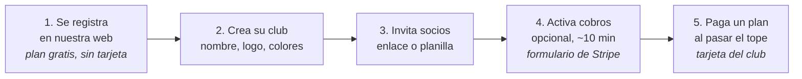
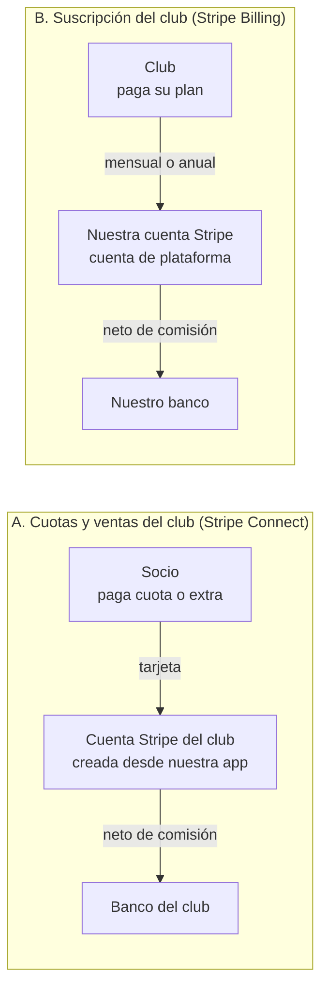
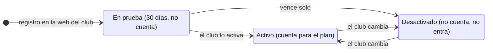
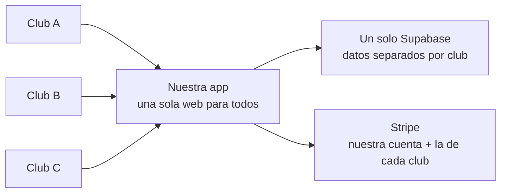
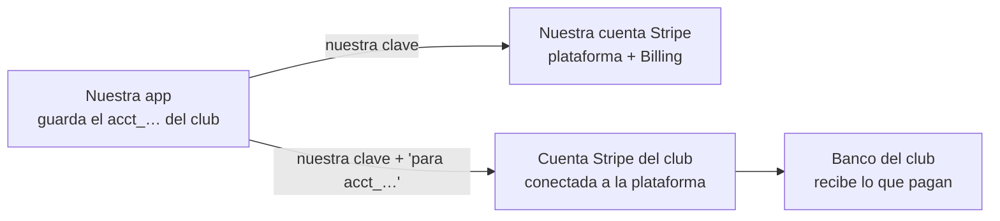
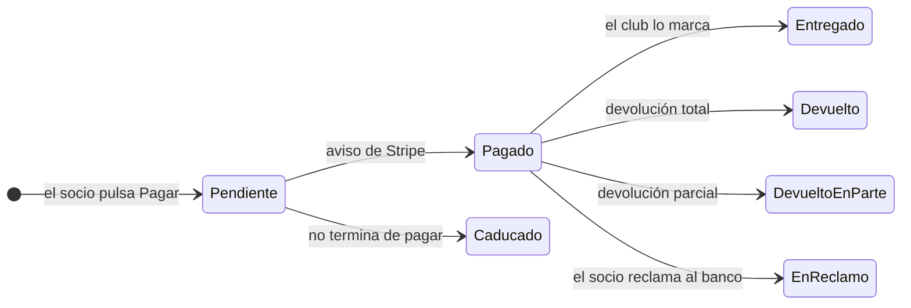

# Plataforma para clubes: flujo y cobros

**Estado:** borrador para discutir · **Fecha:** 6 de noviembre de 2026 · **Dueño:** Camilo (cjgomezr)

Cómo empieza un club, cómo se mueve el dinero y cómo cobramos nosotros. Es la
fuente para el plan de la plataforma (`docs/plan-maestro.md`) y para los PRD que
salgan de él, y la referencia para los mockups de Claude Design. Nace de las
conversaciones del dueño de octubre y noviembre de 2026 y de su documento
`Plataforma_Clubes_Flujo_y_Cobros.pdf`.

La sección 10 lista las pantallas que hacen falta. La 11 compara este documento
con E25 (#663, PRD en el PR #662). La 12 lista lo que falta decidir antes del
plan.

## 1. La idea

Cualquier club entra a nuestra web, crea su organización y empieza a usar la
app el mismo día, sin instalar nada y sin nadie de IT. Hay un plan gratis con
topes; cuando el club crece, paga un plan.

El valor que vendemos frente a las herramientas gratis (Spond, TeamApp) es lo
que ellas no tienen: **entrenamiento con más de 800 ejercicios para armar
rutinas, evaluaciones y creación de equipos**.

## 2. El recorrido de un club

Lo único que pasa fuera de la app es el formulario de Stripe del paso 4, y es
opcional.

- **Plan gratis con topes:** hasta cierto número de usuarios, pocas rutinas y
  un solo ciclo de entrenamiento.
- **Al llegar al tope** no se rompe nada: la app avisa ("llegaste a 30
  usuarios") y ofrece subir de plan.
- **Si el club deja de pagar**, vuelve a los topes del plan gratis o pasa a
  solo lectura. Nunca borramos sus datos.
- Los topes se revisan en el servidor, no solo en la pantalla, para que no se
  puedan saltar.

## 3. Los dos flujos de dinero

Los dos flujos no se mezclan: el dinero de los socios nunca pasa por nuestra
cuenta.

|                        | A. Cuotas de los socios                          | B. Suscripción del club |
| ---------------------- | ------------------------------------------------ | ----------------------- |
| **Paga**               | El socio                                         | El club                 |
| **Recibe**             | El club, en su cuenta Stripe                     | Nosotros                |
| **Herramienta**        | Stripe Connect (cuentas Standard, ver sección 6) | Stripe Billing          |
| **Comisión de Stripe** | La paga el club                                  | La pagamos nosotros     |
| **Comisión nuestra**   | 0% al empezar (se puede activar después)         | No aplica               |

### Cómo activa los cobros un club (flujo A)

- El tesorero pulsa "Activar cobros". Nuestra app le pide a Stripe que cree la
  cuenta del club, o conecta la que ya tiene.
- Llena un formulario de Stripe con nuestro logo: datos del club (ABN si
  tiene), identificación y cuenta bancaria. Es obligatorio por ley y no lo
  podemos llenar por él.
- Vuelve a la app y ya puede cobrar. El club es el comerciante: aparece en el
  extracto del socio, y las devoluciones y reclamos son suyos.
- Un club que no quiere cobrar por la app no toca Stripe nunca.

### Cobros únicos y recurrentes (flujo A)

|                         | Membresías                                                            | Extras de la tienda                                          |
| ----------------------- | --------------------------------------------------------------------- | ------------------------------------------------------------ |
| **Qué define el club**  | Qué opciones ofrece y su precio (por ejemplo: casual, mensual, anual) | El producto, su precio y si se cobra una vez o es recurrente |
| **Qué decide el socio** | Cuál de esas opciones toma                                            | Si lo compra, y la talla u opción                            |

- El club nunca programa cobros a mano ni le dice a Stripe cuándo cobrarle a
  cada socio: eso sale de la opción que el socio eligió.
- **Una vez** (un pack casual, una camiseta, un torneo): el socio paga y
  termina ahí.
- **Recurrente** (la cuota mensual o anual): el socio paga la primera vez y
  Stripe guarda su tarjeta. Desde ahí cobra solo en cada periodo, en la cuenta
  del club. Así funcionan hoy las membresías de los Seadragons.
- **Si un cobro falla** (tarjeta vencida o sin fondos), Stripe reintenta varios
  días y le avisa al socio. La app avisa al club y el socio puede actualizar su
  tarjeta. Si no paga, la membresía queda vencida.
- Stripe asegura que el cobro **se intente** cada periodo, no que el socio
  tenga fondos. Más adelante se puede sumar el débito directo de cuenta
  bancaria (BECS), que falla menos y cuesta menos que la tarjeta.

### Cómo cobramos nosotros (flujo B)

- Los planes viven en Stripe Billing. Al pasar el tope, la app abre la página
  de pago de Stripe; el club pone su tarjeta y listo.
- Stripe cobra solo cada mes o año, envía la factura y reintenta si la tarjeta
  falla. Cada cambio nos llega por aviso automático (webhook) y la app ajusta
  los topes del club.
- El club cambia de plan, de tarjeta o baja sus facturas en el portal de
  cliente de Stripe, sin que tengamos que programarlo.
- Necesitamos empresa con ABN; registro de GST al pasar 75.000 AUD al año
  (Stripe puede calcularlo en la factura).

## 4. Qué cobramos

- **Por usuario, y un usuario es un usuario.** Los roles (Admin, Coach,
  Committee, Player) los decide el club; hacer Admin a todos no cambia el
  precio.
- **Cuentan las cuentas activas.** Las desactivadas, las que están en prueba y
  las que no terminaron el registro no cuentan.
- **Se cobra por el máximo de cuentas activas del mes**, no por las que haya el
  día del cobro. Así no sirve activar 60 personas para un torneo y desactivarlas
  al día siguiente.
- **Para liberar un cupo, el club desactiva la cuenta; no hace falta
  eliminarla.** Una cuenta desactivada no puede iniciar sesión, y su asistencia,
  evaluaciones y pagos quedan intactos. Si el socio vuelve la próxima
  temporada, se reactiva con todo su historial. Ni el club ni nosotros perdemos
  datos.
- **Eliminar queda solo para pedidos de privacidad**, cuando una persona pide
  que se borren sus datos. Aun así, sus pagos se conservan sin nombre: en
  Australia los registros contables se guardan 5 años, Stripe los guarda igual
  y los totales del club no deben cambiar hacia atrás.
- **El primer plan pago empieza en 30 a 40 usuarios.** Un grupo de 5 se arregla
  con WhatsApp.
- **Precio por usuario decreciente** al subir de plan, con descuento por pago
  anual.
- **Sin comisión nuestra sobre los pagos al principio.** El club ya paga la
  suscripción y la comisión de Stripe; sumar otra lo desmotiva.

Precios y topes exactos por definir (sección 12).

### Cuentas de prueba: los curiosos no cuentan

Si cada registro contara, el club tendría que ponerle trabas a la gente nueva.
Por eso quien se registra entra **en prueba**: usa la app como un socio normal
(calendario, asistencia, pagos casuales) y no cuenta para el plan.

La prueba se usa una sola vez: desde ahí la cuenta solo pasa entre Activo y
Desactivado.

- **A los 30 días, si el club no lo activó, la cuenta se desactiva sola.** Lo
  hace una tarea programada diaria; no se pierde nada.
- **Una sola prueba por persona.** La cuenta guarda que ya la usó y nunca
  vuelve a "En prueba".
- **Tope de 50 pruebas nuevas al mes por club.** Al llenarse, quien se registra
  queda en espera, sin acceso, y el club elige: activarlo ya (cuenta desde ese
  momento) o esperar al mes siguiente, cuando se abren 50 cupos nuevos.
- **Para el club la regla es simple:** paga por sus socios, no por los
  curiosos. Puede abrir la puerta a cualquiera sin miedo a la factura, y eso
  también es un argumento de venta.
- Hueco conocido: alguien podría repetir la prueba con otro correo. Cuesta poco
  y no vale la pena frenarlo al principio; si molesta, el club podría aprobar
  cada prueba.

## 5. Qué necesita el club: nada técnico

Ningún club tiene cuenta de Supabase ni necesita entrar al panel de Stripe.
Todo lo gestiona nuestra app.

- **Supabase es nuestro servidor.** Todos los clubes viven en la misma base de
  datos y las reglas de seguridad impiden que un club vea los datos de otro. La
  app ya separa todo por club hoy.
- **El costo de servidores es nuestro** y lo cubre la suscripción de los
  clubes.
- **Los curiosos casi no nos cuestan.** El plan Pro de Supabase (unos US$25 al
  mes) incluye 100.000 usuarios activos al mes, y cada uno extra cuesta
  alrededor de US$0,003. Con 100 clubes de 50 socios y 50 curiosos cada uno
  serían unos 10.000, el 10% de lo incluido. Lo que sí pesa es el espacio de
  archivos (fotos, adjuntos, vídeos) y el tamaño del servidor cuando crezca el
  tráfico. Cifras de Supabase por confirmar en su página de precios.

## 6. Stripe Connect por debajo

El club **no nos da claves ni tokens**. Se conecta una vez y nosotros guardamos
solo el identificador de su cuenta (algo como `acct_1AbC…`).

Con la misma clave secreta operamos en nuestra cuenta o, indicando su
`acct_…`, en la del club.

1. **Activamos Connect una vez** en nuestra cuenta. Stripe revisa el perfil de
   la plataforma.
2. **El club se conecta** desde la app con "Activar cobros": el formulario de
   Stripe del flujo A. Al volver guardamos su `acct_…`.
3. **Para cobrar en su nombre** llamamos a Stripe con nuestra clave y la
   indicación "para esta cuenta". El cobro nace en la cuenta del club y el
   dinero va a su banco.
4. **Un solo receptor de avisos** (webhook de Connect) recibe los pagos de
   todos los clubes, cada uno marcado con su `acct_…`.
5. **El club puede desconectarse** cuando quiera. La app deja de poder cobrar
   por él y nos llega el aviso.

**Connect y Billing son cosas separadas.** Con Connect el club cobra a sus
socios en su cuenta. Con Billing nosotros le cobramos al club la suscripción en
la nuestra, donde el club es un cliente normal con su tarjeta. Existe la opción
de quedarnos un porcentaje de cada cobro (comisión de plataforma), pero el
modelo de la sección 4 no la usa.

### Qué tipo de cuenta tiene el club

|                             | Standard (recomendada)                                                            | Express                                                                         |
| --------------------------- | --------------------------------------------------------------------------------- | ------------------------------------------------------------------------------- |
| **Coste para nosotros**     | Nada extra por club                                                               | Unos 2 USD al mes por club que recibió transferencias, más un poco por cada una |
| **Panel del club**          | El panel completo de Stripe, si lo quiere usar                                    | Un panel básico para ver pagos                                                  |
| **Devoluciones y reclamos** | Del club                                                                          | Compartidos: si el saldo del club queda negativo, responde la plataforma        |
| **Para el club**            | Igual en los dos: se conecta desde la app y no necesita entrar a Stripe para nada | Igual                                                                           |

- **Límites:** no hay un tope práctico de clubes conectados. La API admite del
  orden de 100 lecturas y 100 escrituras por segundo, muy por encima de lo que
  usaremos.
- Precios de Connect para Australia por confirmar en la página de precios de
  Stripe.

## 7. Las pantallas de cada uno

Lo que ve el socio para pagarle al club y lo que ve el Admin para pagarnos a
nosotros son pantallas distintas.

| Pantalla               | Quién | Para qué                                                                       | Hoy    |
| ---------------------- | ----- | ------------------------------------------------------------------------------ | ------ |
| **Payments**           | Socio | Pagar al club membresías y productos. El dinero va a la cuenta del club.       | Existe |
| **Cobros del club**    | Admin | Activar cobros (conectar Stripe), la tienda, los pedidos e informes de ventas. | Nueva  |
| **Plan y facturación** | Admin | Pagarnos: plan, cuentas activas del mes, próximo cobro, tarjeta y facturas.    | Nueva  |

- **Plan y facturación** muestra un resumen nuestro ("Plan Club: 42 cuentas
  activas este mes, próximo cobro 63 AUD el 1 de diciembre"), avisa si un pago
  falla y bloquea con suavidad si el club no paga.
- Poner o cambiar la tarjeta, ver y bajar facturas y cancelar lo hace el
  **portal de cliente de Stripe**: un botón "Gestionar facturación" y listo, sin
  programarlo.
- Cada mes la app le manda a Stripe el máximo de cuentas activas y Stripe
  calcula la factura con el precio por cuenta.

## 8. Tienda del club: dónde se crean los productos

Hoy el comité de los Seadragons crea los extras (por ejemplo, ropa) en el panel
de Stripe y les escribe a mano unas etiquetas ocultas que la app lee: tipo de
producto, tallas y máximo por socio (`seadragons_kind`,
`seadragons_max_quantity`, `seadragons_options`, en
`src/lib/stripe/product-catalog.ts`). Para un club sin IT eso no sirve: un error
de tipeo y el producto no aparece.

La propuesta es una pantalla **"Tienda"** dentro de la app, donde el tesorero
crea el producto (nombre, foto, precio, tallas, máximo por socio) y elige si se
cobra **una vez** o es **recurrente** (mensual, trimestral o anual), lo abre o
cierra a la venta y ve quién compró. Por dentro hay dos opciones.

**Opción A: productos en Stripe.** La app crea cada producto en la cuenta
Stripe del club, por API, y pone ella misma las etiquetas. El club nunca las
ve.

- Reutiliza casi todo lo que existe hoy.
- Hay que mantener sincronizados nuestra base y Stripe.
- La tienda solo funciona si el club activó los cobros.
- Fotos, tallas y stock quedan limitados a lo que Stripe permite.

**Opción B: catálogo en nuestra base (recomendada).** Los productos se guardan
en nuestra base de datos. Al pagar, la app le dice a Stripe qué cobrar y
cuánto; Stripe solo cobra.

- Un solo lugar donde viven los datos.
- Fotos, tallas, stock y productos solo para ciertos socios, a nuestra medida.
- Funciona sin cobros activos (pedidos en efectivo o transferencia).
- Hay que mover los productos actuales de los Seadragons a la base nueva.

## 9. Pedidos e informes de ventas

Con la opción B los productos no están en Stripe, pero cada compra sí lleva su
detalle. El Admin sabe si un socio pagó 3 camisetas talla M o una sola.

- **Nuestra base es la fuente de verdad.** Antes de mandar al socio a Stripe
  guardamos el pedido con sus líneas: "Camiseta Seadragons, talla M, cantidad
  3, 35 AUD cada una". Cuando Stripe avisa del pago, pasa a pagado; si hay
  devolución, a devuelto.
- **Stripe guarda una copia.** Al crear el cobro le mandamos cada línea con
  nombre, precio y cantidad, y el número de nuestro pedido. En el panel del
  club el pago aparece como "Camiseta Seadragons (M) × 3", no como un monto
  suelto.
- **Los informes viven en la app**, en "Cobros del club": quién compró qué,
  cuántas de cada talla, qué falta por entregar, y exportar a CSV para el
  contador. Stripe sabe de dinero, pero no de tallas, entregas ni socios, y
  muchos Admins nunca entrarán a Stripe.

### Devoluciones

El Admin devuelve desde la app, sin entrar a Stripe. Si el club usa su panel de
Stripe, también puede devolver desde ahí y la app se entera igual.

1. En **Cobros del club → Pedidos** abre el pedido y pulsa **Devolver**.
2. Elige qué devuelve: el pedido entero, algunas líneas (1 de las 3 camisetas
   M) o un monto parcial. Escribe el motivo y confirma.
3. La app pide la devolución a Stripe en la cuenta del club, igual que cuando
   cobra en su nombre. El dinero sale del saldo del club, no del nuestro.
4. Cuando Stripe confirma, el pedido queda **Devuelto** o **Devuelto en
   parte**, con el detalle. La ropa devuelta vuelve al stock de su talla. Si
   era una membresía, la app pregunta si se cancela.
5. La bitácora anota quién devolvió, cuánto y por qué.

| Regla                                   | Detalle                                                                                      |
| --------------------------------------- | -------------------------------------------------------------------------------------------- |
| **Quién puede**                         | Solo los roles con permiso de cobros (Admin o tesorero).                                     |
| **Devolución desde el panel de Stripe** | Stripe nos avisa por el webhook y la app actualiza el pedido. Los informes no se descuadran. |
| **Cuándo le llega al socio**            | Entre 5 y 10 días hábiles en su tarjeta, según el banco.                                     |
| **Comisión**                            | Stripe no devuelve la comisión del pago original: el club la pierde.                         |
| **Sin saldo en Stripe**                 | Si el club ya transfirió todo a su banco, Stripe cobra la devolución de su cuenta bancaria.  |
| **Varias devoluciones parciales**       | Se permiten hasta llegar al total pagado, nunca más.                                         |

**Un reclamo no es una devolución.** Es cuando el socio le reclama a su banco en
vez de al club. Stripe avisa, el pedido queda **En reclamo** y el club sube sus
pruebas desde su panel de Stripe (más adelante, quizá desde la app). Si pierde,
el dinero vuelve al socio y el club paga además una tarifa por reclamo, de unos
25 AUD. Tarifa por confirmar en la página de precios de Stripe.

## 10. Pantallas que hacen falta

La lista para los mockups de Claude Design. Todas en escritorio y móvil, tema
claro y oscuro, inglés y español, con el sistema de diseño de hoy
(`design-system.md`).

| Pantalla                     | Quién             | Qué tiene                                                                                                                           |
| ---------------------------- | ----------------- | ----------------------------------------------------------------------------------------------------------------------------------- |
| **Portada y precios**        | Cualquiera        | Qué es la plataforma, lo que la diferencia (sección 1), los planes y el botón para crear un club.                                   |
| **Crear club**               | Quien se registra | Pasos: su cuenta, nombre y slug del club, logo y colores, primeros socios.                                                          |
| **Invitar socios**           | Admin             | Enlace para compartir y carga de una planilla, con la vista previa de lo que se importa.                                            |
| **Pruebas en espera**        | Admin             | Quién está en prueba, cuántos días le quedan, los que esperan cupo, y activar o desactivar.                                         |
| **Aviso de tope**            | Admin             | El aviso al llegar al tope del plan, con el botón para subir de plan.                                                               |
| **Plan y facturación**       | Admin             | Sección 7.                                                                                                                          |
| **Cobros del club: activar** | Admin             | El estado de la conexión con Stripe (sin conectar, pendiente de datos, activo, desconectado).                                       |
| **Tienda**                   | Admin             | Lista de productos y el formulario: nombre, foto, precio, tallas, stock, máximo por socio, una vez o recurrente, abierto o cerrado. |
| **Pedidos**                  | Admin             | Lista con filtros por estado y producto, el detalle de un pedido, marcar entregado y devolver.                                      |
| **Informes de ventas**       | Admin             | Totales por producto y talla, pendientes de entregar, exportar a CSV.                                                               |
| **Payments (cambios)**       | Socio             | La tienda con los productos de la opción B y sus pedidos con su estado.                                                             |
| **Club no encontrado**       | Cualquiera        | Ya está en E25 (RF-1).                                                                                                              |

## 11. Relación con E25 (#663, PRD en el PR #662)

E25 hace que una instalación sirva a varios clubes, cada uno en su subdominio.
Es la base técnica de este documento, y casi todo encaja. Lo que hay que
decidir está en la última columna.

| Tema                           | E25 dice                                                                    | Este documento dice                          | Qué hacer                                                                                                              |
| ------------------------------ | --------------------------------------------------------------------------- | -------------------------------------------- | ---------------------------------------------------------------------------------------------------------------------- |
| Datos separados por club       | `club_id` y RLS, suite de aislamiento con dos clubes                        | Un solo Supabase con datos separados         | Encaja. E25 va primero.                                                                                                |
| Dirección de cada club         | Subdominio `<slug>.<dominio>`; sin subdominio, 404 si hay varios clubes     | "Se registra en nuestra web"                 | Falta una web raíz (portada, precios, crear club) en el dominio base o en `www`. E25 la rechaza hoy.                   |
| Alta de clubes                 | Por script; pantalla y rol de plataforma fuera de alcance                   | El club se crea solo, el mismo día           | Épica nueva: alta self-serve y un rol de plataforma para nosotros.                                                     |
| Stripe                         | Una cuenta por instalación; solo cobra el club de `STRIPE_CLUB_SLUG` (RF-7) | Connect: cada club con su cuenta             | No se contradicen: E25 deja Connect para su propia épica. Si Connect llega pronto, RF-7 (#670) es trabajo que se tira. |
| Correo                         | Un remitente para la instalación, con la marca de cada club                 | Nada                                         | Encaja.                                                                                                                |
| Una persona en dos clubes      | No: una cuenta por club, dos correos si quiere estar en dos                 | La prueba es "una por persona"               | Aclarar que es una por cuenta y club. Un Coach de dos clubes necesita dos correos: ¿sirve así para vender?             |
| Zona horaria                   | Todos en `Australia/Melbourne`                                              | Nada                                         | Si vendemos fuera de Melbourne (Perth, Nueva Zelanda), hace falta una épica.                                           |
| Cupo de correos del directorio | Uno para toda la instalación                                                | Nada                                         | Con muchos clubes, un club puede gastar el cupo de los demás. Va en la épica de planes y topes.                        |
| Estados de la cuenta           | `incomplete`, `active`, `inactive` como hoy                                 | Nuevo estado "En prueba" y la cola de espera | Épica nueva (sección 4).                                                                                               |
| B8: qué dominio                | Sin resolver; bloquea la producción de los subdominios                      | Nada                                         | Lo decide el dueño. También decide dónde vive la portada.                                                              |

E23 (rediseño de pagos) ya hizo la pantalla de extras que lee los productos de
Stripe con sus etiquetas. La opción B de la sección 8 cambia de dónde salen,
así que toca esa pantalla.

## 12. Lo que falta decidir antes del plan

Las respuestas van en este documento o en `docs/preguntas-abiertas.md`.

1. **Precios y topes:** cuántos usuarios, rutinas y ciclos tiene el plan
   gratis; cuántos planes pagos y a qué precio por cuenta; el descuento anual.
2. **Qué pasa si el club deja de pagar:** vuelve a los topes del plan gratis o
   pasa a solo lectura. El documento dice las dos.
3. **Mercado:** solo Australia (AUD, ABN, GST, Melbourne) o también otros
   países. Cambia monedas, impuestos y zonas horarias.
4. **Dominio (B8)** y dónde vive la portada.
5. **Rol de plataforma:** qué vemos y hacemos nosotros (lista de clubes,
   suspender, ayudar a un club, métricas) y quién tiene ese rol.
6. **Legal:** términos de servicio, política de privacidad, quién es
   responsable de los datos de los socios (el club o nosotros), y la empresa con
   ABN para Stripe.
7. **Cómo pasa Seadragons al modelo nuevo:** conectar su cuenta de Stripe
   actual como cuenta Standard, mover sus extras a la tienda nueva y desde
   cuándo nos paga (o si queda gratis como primer club).
8. **Tienda:** si hay stock por talla, si hay pedidos en efectivo o
   transferencia, si el club cobra GST en lo que vende (Stripe Tax).
9. **Invitar con planilla:** qué columnas trae y qué pasa con los correos
   repetidos.
10. **Cuando un club se va:** exportar sus datos y cuánto tiempo los guardamos
    antes de borrarlos.
11. **Orden con E25:** si se sigue con E25 tal cual (incluido RF-7) o se ajusta
    con lo de arriba. Lo tiene que ver Sebastián, que es el dueño de esa épica.
