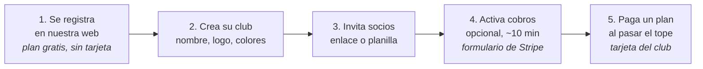
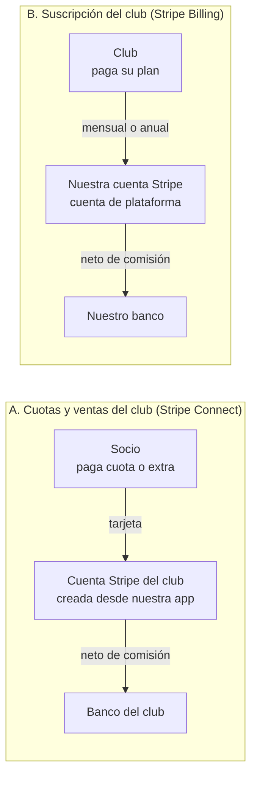
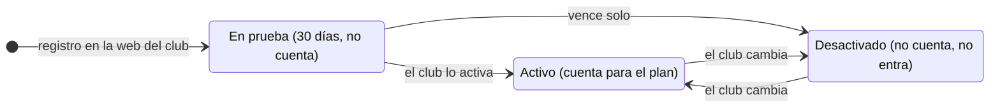
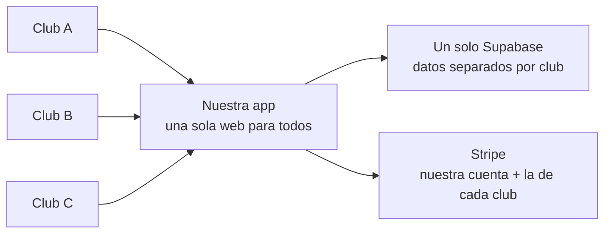
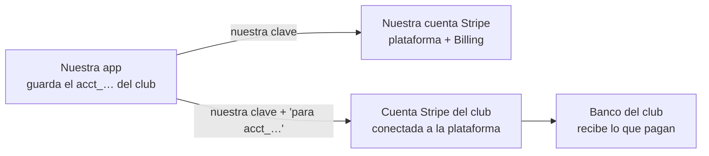
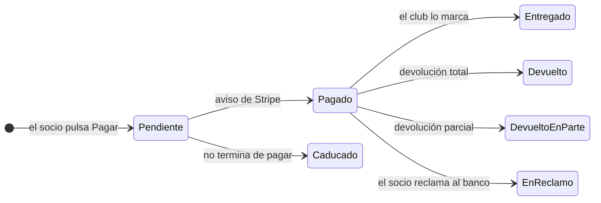
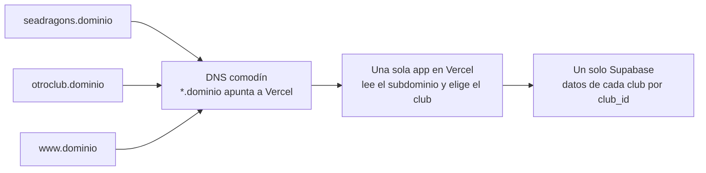
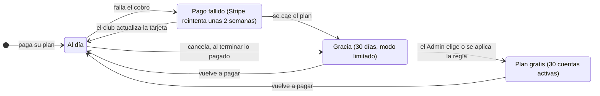

# Plataforma para clubes: flujo y cobros

**Estado:** borrador para discutir · **Fecha:** 6 de noviembre de 2026 (decisiones del dueño en las secciones 12 a 19) · **Dueño:** Camilo (cjgomezr)

Cómo empieza un club, cómo se mueve el dinero y cómo cobramos nosotros. Es la
fuente para el plan de la plataforma (`docs/plan-maestro.md`) y para los PRD que
salgan de él, y la referencia para los mockups de Claude Design. Nace de las
conversaciones del dueño de octubre y noviembre de 2026 y de su documento
`Plataforma_Clubes_Flujo_y_Cobros.pdf`.

Mapa del documento:

- Secciones 1 a 9: el modelo (recorrido, dinero, cobro, Stripe Connect, tienda,
  pedidos y devoluciones).
- Sección 10: las pantallas que hacen falta, para Claude Design.
- Sección 11: comparación con E25 (#663, PRD en el PR #662).
- Secciones 12 a 19: las decisiones del 6 de noviembre de 2026 (dominio,
  planes y topes, qué pasa si el club deja de pagar, una persona en varios
  clubes, otros países, correos, soporte, legal y datos de un club que se va).
- Sección 20: lo que sigue abierto.

## 1. La idea

Cualquier club entra a nuestra web, crea su organización y empieza a usar la
app el mismo día, sin instalar nada y sin nadie de IT. Hay un plan gratis con
topes; cuando el club crece, paga un plan.

La puerta de entrada es una landing en nuestro dominio, con los precios y el
botón "Crear club". Cada club vive en su subdominio (sección 12).

El valor que vendemos frente a las herramientas gratis (Spond, TeamApp) es lo
que ellas no tienen: **entrenamiento con más de 800 ejercicios para armar
rutinas, evaluaciones y creación de equipos**.

## 2. El recorrido de un club

Lo único que pasa fuera de la app es el formulario de Stripe del paso 4, y es
opcional.

- **Plan gratis con topes:** 30 cuentas activas, un solo ciclo de
  entrenamiento, 5 rutinas y 3 grupos (sección 13).
- **Al llegar al tope** no se rompe nada: la app avisa ("llegaste a 30
  usuarios") y ofrece subir de plan.
- **Si el club deja de pagar**, pasa al plan gratis con un periodo de gracia y
  elige qué se queda activo (sección 14). Nunca borramos sus datos.
- Los topes se revisan en el servidor, no solo en la pantalla, para que no se
  puedan saltar.

## 3. Los dos flujos de dinero

Los dos flujos no se mezclan: el dinero de los socios nunca pasa por nuestra
cuenta.

|                        | A. Cuotas de los socios                              | B. Suscripción del club |
| ---------------------- | ---------------------------------------------------- | ----------------------- |
| **Paga**               | El socio                                             | El club                 |
| **Recibe**             | El club, en su cuenta Stripe                         | Nosotros                |
| **Herramienta**        | Stripe Connect (cuentas Standard, ver sección 6)     | Stripe Billing          |
| **Comisión de Stripe** | La paga el club                                      | La pagamos nosotros     |
| **Comisión nuestra**   | 0% en los planes pagos; 1% en el gratis (sección 13) | No aplica               |

### Cómo activa los cobros un club (flujo A)

- El tesorero pulsa "Activar cobros". Nuestra app le pide a Stripe que cree la
  cuenta del club, o conecta la que ya tiene.
- Llena un formulario de Stripe con nuestro logo: datos del club (ABN si
  tiene), identificación y cuenta bancaria. Es obligatorio por ley y no lo
  podemos llenar por él.
- Vuelve a la app y ya puede cobrar. El club es el comerciante: aparece en el
  extracto del socio, y las devoluciones y reclamos son suyos.
- Un club que no quiere cobrar por la app no toca Stripe nunca.

### Cobros únicos y recurrentes (flujo A)

|                         | Membresías                                                            | Extras de la tienda                                          |
| ----------------------- | --------------------------------------------------------------------- | ------------------------------------------------------------ |
| **Qué define el club**  | Qué opciones ofrece y su precio (por ejemplo: casual, mensual, anual) | El producto, su precio y si se cobra una vez o es recurrente |
| **Qué decide el socio** | Cuál de esas opciones toma                                            | Si lo compra, y la talla u opción                            |

- El club nunca programa cobros a mano ni le dice a Stripe cuándo cobrarle a
  cada socio: eso sale de la opción que el socio eligió.
- **Una vez** (un pack casual, una camiseta, un torneo): el socio paga y
  termina ahí.
- **Recurrente** (la cuota mensual o anual): el socio paga la primera vez y
  Stripe guarda su tarjeta. Desde ahí cobra solo en cada periodo, en la cuenta
  del club. Así funcionan hoy las membresías de los Seadragons.
- **Si un cobro falla** (tarjeta vencida o sin fondos), Stripe reintenta varios
  días y le avisa al socio. La app avisa al club y el socio puede actualizar su
  tarjeta. Si no paga, la membresía queda vencida.
- Stripe asegura que el cobro **se intente** cada periodo, no que el socio
  tenga fondos. Más adelante se puede sumar el débito directo de cuenta
  bancaria (BECS), que falla menos y cuesta menos que la tarjeta.

### Cómo cobramos nosotros (flujo B)

- Los planes viven en Stripe Billing. Al pasar el tope, la app abre la página
  de pago de Stripe; el club pone su tarjeta y listo.
- Stripe cobra solo cada mes o año, envía la factura y reintenta si la tarjeta
  falla. Cada cambio nos llega por aviso automático (webhook) y la app ajusta
  los topes del club.
- El club cambia de plan, de tarjeta o baja sus facturas en el portal de
  cliente de Stripe, sin que tengamos que programarlo.
- Necesitamos empresa con ABN; registro de GST al pasar 75.000 AUD al año
  (Stripe puede calcularlo en la factura).

## 4. Qué cobramos

- **Por usuario, y un usuario es un usuario.** Los roles (Admin, Coach,
  Committee, Player) los decide el club; hacer Admin a todos no cambia el
  precio.
- **Cuentan las cuentas activas.** Las desactivadas, las que están en prueba y
  las que no terminaron el registro no cuentan.
- **Se cobra por el máximo de cuentas activas del mes**, no por las que haya el
  día del cobro. Así no sirve activar 60 personas para un torneo y desactivarlas
  al día siguiente.
- **Para liberar un cupo, el club desactiva la cuenta; no hace falta
  eliminarla.** Una cuenta desactivada no puede iniciar sesión, y su asistencia,
  evaluaciones y pagos quedan intactos. Si el socio vuelve la próxima
  temporada, se reactiva con todo su historial. Ni el club ni nosotros perdemos
  datos.
- **Eliminar queda solo para pedidos de privacidad**, cuando una persona pide
  que se borren sus datos. Aun así, sus pagos se conservan sin nombre: en
  Australia los registros contables se guardan 5 años, Stripe los guarda igual
  y los totales del club no deben cambiar hacia atrás.
- **El primer plan pago empieza en 31 cuentas activas.** Hasta 30, el club
  usa el plan gratis.
- **Precio por cuenta decreciente** al crecer, con descuento por pago anual.
- **Sin comisión nuestra sobre los pagos en los planes pagos.** El club ya paga
  la suscripción y la comisión de Stripe; sumar otra lo desmotiva.

Los precios y topes están en la sección 13.

### Cuentas de prueba: los curiosos no cuentan

Si cada registro contara, el club tendría que ponerle trabas a la gente nueva.
Por eso quien se registra entra **en prueba**: usa la app como un socio normal
(calendario, asistencia, pagos casuales) y no cuenta para el plan.

La prueba se usa una sola vez: desde ahí la cuenta solo pasa entre Activo y
Desactivado.

- **A los 30 días, si el club no lo activó, la cuenta se desactiva sola.** Lo
  hace una tarea programada diaria; no se pierde nada.
- **Una sola prueba por persona y club.** La ficha del socio en ese club
  guarda que ya la usó y nunca vuelve a "En prueba". Si la misma persona se
  registra en otro club (sección 15), allí tiene su propia prueba.
- **Tope de 20 pruebas nuevas al mes por club, en todos los planes.** Al
  llenarse, quien se registra queda en espera, sin acceso, y el club elige:
  activarlo ya (cuenta desde ese momento) o esperar al mes siguiente, cuando se
  abren 20 cupos nuevos. El PDF original decía 50; el dueño lo bajó a 20 el 6
  de noviembre de 2026.
- **Para el club la regla es simple:** paga por sus socios, no por los
  curiosos. Puede abrir la puerta a cualquiera sin miedo a la factura, y eso
  también es un argumento de venta.
- Hueco conocido: alguien podría repetir la prueba con otro correo. Cuesta poco
  y no vale la pena frenarlo al principio; si molesta, el club podría aprobar
  cada prueba.

## 5. Qué necesita el club: nada técnico

Ningún club tiene cuenta de Supabase ni necesita entrar al panel de Stripe.
Todo lo gestiona nuestra app.

- **Supabase es nuestro servidor.** Todos los clubes viven en la misma base de
  datos y las reglas de seguridad impiden que un club vea los datos de otro. La
  app ya separa todo por club hoy.
- **El costo de servidores es nuestro** y lo cubre la suscripción de los
  clubes.
- **Los curiosos casi no nos cuestan.** El plan Pro de Supabase (unos US$25 al
  mes) incluye 100.000 usuarios activos al mes, y cada uno extra cuesta
  alrededor de US$0,003. Con 100 clubes de 50 socios y 50 curiosos cada uno
  serían unos 10.000, el 10% de lo incluido. Lo que sí pesa es el espacio de
  archivos (fotos, adjuntos, vídeos) y el tamaño del servidor cuando crezca el
  tráfico. Cifras de Supabase por confirmar en su página de precios.

**Lo que nos cuesta al mes para empezar** (noviembre de 2026, precios por
confirmar en cada página):

| Servicio | Para qué                                                         | Costo                                                                                              |
| -------- | ---------------------------------------------------------------- | -------------------------------------------------------------------------------------------------- |
| Supabase | La base de datos, las cuentas y los archivos de todos los clubes | Plan Pro, unos 25 USD; el proyecto de desarrollo suma unos 10 USD si vive en la misma organización |
| Vercel   | La app de todos los clubes y la landing, en el mismo proyecto    | Plan Pro, unos 20 USD por persona del equipo. El plan gratis (Hobby) no permite uso comercial      |
| Resend   | Los correos                                                      | Unos 20 USD con el plan Pro (sección 17)                                                           |
| Dominio  | La landing y los subdominios                                     | Unos 15 a 20 USD al año                                                                            |
| Stripe   | Connect y Billing                                                | Sin cuota mensual: solo comisiones por cobro                                                       |

En total, unos 65 a 75 USD al mes más el dominio. Sube con el uso: el tamaño
del servidor de Supabase cuando crezca el tráfico, el espacio de archivos y las
personas del equipo en Vercel.

## 6. Stripe Connect por debajo

El club **no nos da claves ni tokens**. Se conecta una vez y nosotros guardamos
solo el identificador de su cuenta (algo como `acct_1AbC…`).

Con la misma clave secreta operamos en nuestra cuenta o, indicando su
`acct_…`, en la del club.

1. **Activamos Connect una vez** en nuestra cuenta. Stripe revisa el perfil de
   la plataforma.
2. **El club se conecta** desde la app con "Activar cobros": el formulario de
   Stripe del flujo A. Al volver guardamos su `acct_…`.
3. **Para cobrar en su nombre** llamamos a Stripe con nuestra clave y la
   indicación "para esta cuenta". El cobro nace en la cuenta del club y el
   dinero va a su banco.
4. **Un solo receptor de avisos** (webhook de Connect) recibe los pagos de
   todos los clubes, cada uno marcado con su `acct_…`.
5. **El club puede desconectarse** cuando quiera. La app deja de poder cobrar
   por él y nos llega el aviso.

**Connect y Billing son cosas separadas.** Con Connect el club cobra a sus
socios en su cuenta. Con Billing nosotros le cobramos al club la suscripción en
la nuestra, donde el club es un cliente normal con su tarjeta. Existe la opción
de quedarnos un porcentaje de cada cobro (comisión de plataforma), pero el
modelo de la sección 4 no la usa.

### Qué tipo de cuenta tiene el club

|                             | Standard (recomendada)                                                            | Express                                                                         |
| --------------------------- | --------------------------------------------------------------------------------- | ------------------------------------------------------------------------------- |
| **Coste para nosotros**     | Nada extra por club                                                               | Unos 2 USD al mes por club que recibió transferencias, más un poco por cada una |
| **Panel del club**          | El panel completo de Stripe, si lo quiere usar                                    | Un panel básico para ver pagos                                                  |
| **Devoluciones y reclamos** | Del club                                                                          | Compartidos: si el saldo del club queda negativo, responde la plataforma        |
| **Para el club**            | Igual en los dos: se conecta desde la app y no necesita entrar a Stripe para nada | Igual                                                                           |

- **Límites:** no hay un tope práctico de clubes conectados. La API admite del
  orden de 100 lecturas y 100 escrituras por segundo, muy por encima de lo que
  usaremos.
- Precios de Connect para Australia por confirmar en la página de precios de
  Stripe.

## 7. Las pantallas de cada uno

Lo que ve el socio para pagarle al club y lo que ve el Admin para pagarnos a
nosotros son pantallas distintas.

| Pantalla               | Quién | Para qué                                                                       | Hoy    |
| ---------------------- | ----- | ------------------------------------------------------------------------------ | ------ |
| **Payments**           | Socio | Pagar al club membresías y productos. El dinero va a la cuenta del club.       | Existe |
| **Cobros del club**    | Admin | Activar cobros (conectar Stripe), la tienda, los pedidos e informes de ventas. | Nueva  |
| **Plan y facturación** | Admin | Pagarnos: plan, cuentas activas del mes, próximo cobro, tarjeta y facturas.    | Nueva  |

- **Plan y facturación** muestra un resumen nuestro ("Plan Club: 42 cuentas
  activas este mes, próximo cobro 63 AUD el 1 de diciembre"), avisa si un pago
  falla y bloquea con suavidad si el club no paga.
- Poner o cambiar la tarjeta, ver y bajar facturas y cancelar lo hace el
  **portal de cliente de Stripe**: un botón "Gestionar facturación" y listo, sin
  programarlo.
- Cada mes la app le manda a Stripe el máximo de cuentas activas y Stripe
  calcula la factura con el precio por cuenta.

## 8. Tienda del club: dónde se crean los productos

Hoy el comité de los Seadragons crea los extras (por ejemplo, ropa) en el panel
de Stripe y les escribe a mano unas etiquetas ocultas que la app lee: tipo de
producto, tallas y máximo por socio (`seadragons_kind`,
`seadragons_max_quantity`, `seadragons_options`, en
`src/lib/stripe/product-catalog.ts`). Para un club sin IT eso no sirve: un error
de tipeo y el producto no aparece.

La propuesta es una pantalla **"Tienda"** dentro de la app, donde el tesorero
crea el producto (nombre, foto, precio, tallas, máximo por socio) y elige si se
cobra **una vez** o es **recurrente** (mensual, trimestral o anual), lo abre o
cierra a la venta y ve quién compró. Por dentro hay dos opciones.

**Opción A: productos en Stripe.** La app crea cada producto en la cuenta
Stripe del club, por API, y pone ella misma las etiquetas. El club nunca las
ve.

- Reutiliza casi todo lo que existe hoy.
- Hay que mantener sincronizados nuestra base y Stripe.
- La tienda solo funciona si el club activó los cobros.
- Fotos, tallas y stock quedan limitados a lo que Stripe permite.

**Opción B: catálogo en nuestra base (recomendada).** Los productos se guardan
en nuestra base de datos. Al pagar, la app le dice a Stripe qué cobrar y
cuánto; Stripe solo cobra.

- Un solo lugar donde viven los datos.
- Fotos, tallas, stock y productos solo para ciertos socios, a nuestra medida.
- Funciona sin cobros activos (pedidos en efectivo o transferencia).
- No hay nada que migrar: los Seadragons todavía no usan la app, así que la
  tienda nueva arranca limpia.

## 9. Pedidos e informes de ventas

Con la opción B los productos no están en Stripe, pero cada compra sí lleva su
detalle. El Admin sabe si un socio pagó 3 camisetas talla M o una sola.

- **Nuestra base es la fuente de verdad.** Antes de mandar al socio a Stripe
  guardamos el pedido con sus líneas: "Camiseta Seadragons, talla M, cantidad
  3, 35 AUD cada una". Cuando Stripe avisa del pago, pasa a pagado; si hay
  devolución, a devuelto.
- **Stripe guarda una copia.** Al crear el cobro le mandamos cada línea con
  nombre, precio y cantidad, y el número de nuestro pedido. En el panel del
  club el pago aparece como "Camiseta Seadragons (M) × 3", no como un monto
  suelto.
- **Los informes viven en la app**, en "Cobros del club": quién compró qué,
  cuántas de cada talla, qué falta por entregar, y exportar a CSV para el
  contador. Stripe sabe de dinero, pero no de tallas, entregas ni socios, y
  muchos Admins nunca entrarán a Stripe.

### Devoluciones

El Admin devuelve desde la app, sin entrar a Stripe. Si el club usa su panel de
Stripe, también puede devolver desde ahí y la app se entera igual.

1. En **Cobros del club → Pedidos** abre el pedido y pulsa **Devolver**.
2. Elige qué devuelve: el pedido entero, algunas líneas (1 de las 3 camisetas
   M) o un monto parcial. Escribe el motivo y confirma.
3. La app pide la devolución a Stripe en la cuenta del club, igual que cuando
   cobra en su nombre. El dinero sale del saldo del club, no del nuestro.
4. Cuando Stripe confirma, el pedido queda **Devuelto** o **Devuelto en
   parte**, con el detalle. La ropa devuelta vuelve al stock de su talla. Si
   era una membresía, la app pregunta si se cancela.
5. La bitácora anota quién devolvió, cuánto y por qué.

| Regla                                   | Detalle                                                                                      |
| --------------------------------------- | -------------------------------------------------------------------------------------------- |
| **Quién puede**                         | Solo los roles con permiso de cobros (Admin o tesorero).                                     |
| **Devolución desde el panel de Stripe** | Stripe nos avisa por el webhook y la app actualiza el pedido. Los informes no se descuadran. |
| **Cuándo le llega al socio**            | Entre 5 y 10 días hábiles en su tarjeta, según el banco.                                     |
| **Comisión**                            | Stripe no devuelve la comisión del pago original: el club la pierde.                         |
| **Sin saldo en Stripe**                 | Si el club ya transfirió todo a su banco, Stripe cobra la devolución de su cuenta bancaria.  |
| **Varias devoluciones parciales**       | Se permiten hasta llegar al total pagado, nunca más.                                         |

**Un reclamo no es una devolución.** Es cuando el socio le reclama a su banco en
vez de al club. Stripe avisa, el pedido queda **En reclamo** y el club sube sus
pruebas desde su panel de Stripe (más adelante, quizá desde la app). Si pierde,
el dinero vuelve al socio y el club paga además una tarifa por reclamo, de unos
25 AUD. Tarifa por confirmar en la página de precios de Stripe.

## 10. Pantallas que hacen falta

La lista para los mockups de Claude Design. Todas en escritorio y móvil, tema
claro y oscuro, inglés y español, con el sistema de diseño de hoy
(`design-system.md`).

| Pantalla                      | Quién             | Qué tiene                                                                                                                                            |
| ----------------------------- | ----------------- | ---------------------------------------------------------------------------------------------------------------------------------------------------- |
| **Portada y precios**         | Cualquiera        | Qué es la plataforma, lo que la diferencia (sección 1), los planes y el botón para crear un club.                                                    |
| **Crear club**                | Quien se registra | Pasos: su cuenta, nombre y slug del club, logo y colores, primeros socios.                                                                           |
| **Invitar socios**            | Admin             | Enlace para compartir y carga de una planilla, con la vista previa de lo que se importa.                                                             |
| **Pruebas en espera**         | Admin             | Quién está en prueba, cuántos días le quedan, los que esperan cupo, y activar o desactivar.                                                          |
| **Aviso de tope**             | Admin             | El aviso al llegar al tope del plan, con el botón para subir de plan.                                                                                |
| **Plan y facturación**        | Admin             | Sección 7.                                                                                                                                           |
| **Cobros del club: activar**  | Admin             | El estado de la conexión con Stripe (sin conectar, pendiente de datos, activo, desconectado).                                                        |
| **Tienda**                    | Admin             | Lista de productos y el formulario: nombre, foto, precio, tallas, stock, máximo por socio, una vez o recurrente, abierto o cerrado.                  |
| **Pedidos**                   | Admin             | Lista con filtros por estado y producto, el detalle de un pedido, marcar entregado y devolver.                                                       |
| **Informes de ventas**        | Admin             | Totales por producto y talla, pendientes de entregar, exportar a CSV.                                                                                |
| **Payments (cambios)**        | Socio             | La tienda con los productos de la opción B y sus pedidos con su estado.                                                                              |
| **Club no encontrado**        | Cualquiera        | Ya está en E25 (RF-1).                                                                                                                               |
| **Mis clubes**                | Socio             | En el dominio raíz: los clubes de la persona, para saltar de uno a otro (sección 15).                                                                |
| **Elegir cuentas activas**    | Admin             | Al bajar al plan gratis: la lista de cuentas con un contador "30 de 30", las que pagan cuota marcadas, y los días de gracia que quedan (sección 14). |
| **Elegir ciclo activo**       | Admin             | Al bajar al plan gratis con varios ciclos activos: cuál sigue activo (sección 14).                                                                   |
| **Aviso de plan caído**       | Admin             | El aviso fijo durante la gracia, y el aviso de pago fallido.                                                                                         |
| **Cancelar el plan**          | Admin             | Antes de confirmar, lo que va a pasar: cuántas cuentas sobran, qué ciclos se archivan, desde qué fecha.                                              |
| **Panel de plataforma**       | Nosotros          | Lista de clubes, ficha de un club, métricas y avisos a todos los Admins (sección 18).                                                                |
| **Acceso de soporte**         | Admin             | Dar o quitar permiso temporal a soporte para ver su club, y ver cuándo entramos.                                                                     |
| **Exportar y borrar el club** | Admin             | Descargar todos los datos del club y pedir el borrado con sus 30 días de margen (sección 19).                                                        |

## 11. Relación con E25 (#663, PRD en el PR #662)

E25 hace que una instalación sirva a varios clubes, cada uno en su subdominio.
Es la base técnica de este documento, y casi todo encaja. Con las decisiones
del 6 de noviembre de 2026 (secciones 12 a 19), cuatro cosas de E25 cambian.
Las tiene que ver Sebastián, que es el dueño de esa épica, antes de trabajar
sus tickets.

| Tema                           | E25 dice                                                                    | Decisión de este documento                                                | Qué cambia en E25                                                                                            |
| ------------------------------ | --------------------------------------------------------------------------- | ------------------------------------------------------------------------- | ------------------------------------------------------------------------------------------------------------ |
| Datos separados por club       | `club_id` y RLS, suite de aislamiento con dos clubes                        | Un solo Supabase con datos separados                                      | Nada. E25 va primero.                                                                                        |
| Dirección de cada club         | Subdominio `<slug>.<dominio>`; sin subdominio, 404 si hay varios clubes     | El dominio raíz sirve la landing (sección 12)                             | **Cambia:** la raíz y `www` sirven la landing en vez de "club no encontrado". `www` ya es un slug reservado. |
| B8: qué dominio                | Sin resolver; bloquea la producción de los subdominios                      | Un dominio nuevo para la plataforma (sección 12)                          | **Se resuelve** en cuanto el dueño lo compre.                                                                |
| Stripe                         | Una cuenta por instalación; solo cobra el club de `STRIPE_CLUB_SLUG` (RF-7) | Stripe Connect desde el inicio                                            | **Cambia:** el #670 (RF-7) sobra. Lo sustituye la épica de Connect.                                          |
| Una persona en dos clubes      | No: una cuenta por club (`members.user_id` único)                           | Sí: una identidad, una ficha por club (sección 15)                        | **Cambia:** se revierte la decisión. Es una épica propia, después del #665.                                  |
| Alta de clubes                 | Por script (#672); pantalla y rol de plataforma fuera de alcance            | El club se crea solo desde la landing; hay rol de plataforma (sección 18) | El script sigue sirviendo para pruebas. El alta self-serve y el rol de plataforma son épicas nuevas.         |
| Zona horaria                   | Todos en `Australia/Melbourne`                                              | Clubes de otros países (sección 16)                                       | Épica nueva: zona horaria y moneda por club.                                                                 |
| Correo                         | Un remitente para la instalación, con la marca de cada club                 | Igual, con Resend de pago (sección 17)                                    | Nada.                                                                                                        |
| Cupo de correos del directorio | Uno para toda la instalación                                                | Uno por club, según su plan (sección 17)                                  | Va en la épica de planes y topes.                                                                            |
| Estados de la cuenta           | `incomplete`, `active`, `inactive` como hoy                                 | Nuevo estado "En prueba" y la cola de espera (sección 4)                  | Épica nueva.                                                                                                 |

E23 (rediseño de pagos) ya hizo la pantalla de extras que lee los productos de
Stripe con sus etiquetas. La opción B de la sección 8 cambia de dónde salen,
así que toca esa pantalla.

## 12. Dominio y landing

- **El dueño compra un dominio nuevo para la plataforma.** El candidato es
  `pacifikcode.com`, sin comprar todavía. Si la app va a tener nombre propio,
  conviene un dominio con el nombre del producto y dejar `pacifikcode.com` para
  la empresa: `seadragons.<producto>.com` se lee mejor que
  `seadragons.pacifikcode.com`.
- **La landing vive en el dominio raíz y en `www`:** qué es la app, lo que la
  diferencia (sección 1), los planes (sección 13) y el botón "Crear club".
- **Cada club vive en `<slug>.<dominio>`**, como dice E25.
- **Requisito técnico:** el dominio usa los nameservers de Vercel, porque
  Vercel solo acepta el comodín `*.<dominio>` así. Se configura al comprarlo.

**Dónde se aloja cada club.** En ningún sitio aparte: todos los clubes son la
misma app, en el mismo proyecto de Vercel.

- **Un solo registro DNS** (`*.<dominio>`) manda todos los subdominios, también
  los que todavía no existen, a la misma app. Vercel emite solo el certificado
  HTTPS del comodín.
- **La app lee el subdominio de cada petición** y busca el club con ese slug
  (E25, RF-1). `www` y la raíz sirven la landing.
- **Crear un club es crear una fila** en la base con su slug. Su subdominio
  funciona al instante: no se toca el DNS, no se despliega nada y no hay un
  servidor por club.
- **No hace falta un hosting potente.** Vercel ejecuta la app por petición y
  escala solo; se paga por uso. Lo que crece con los clubes es la base de
  datos: el servidor de Supabase se sube de tamaño desde su panel cuando el
  tráfico lo pida.

## 13. Planes y topes

Decididos el 6 de noviembre de 2026. Los precios son un punto de partida: se
prueban con 3 a 5 clubes antes de fijarlos.

| Plan       | Cuentas activas | Precio                                                                        | Topes                                                                                        |
| ---------- | --------------- | ----------------------------------------------------------------------------- | -------------------------------------------------------------------------------------------- |
| **Gratis** | Hasta 30        | 0                                                                             | 20 pruebas nuevas al mes, 1 ciclo de entrenamiento, 5 rutinas, 3 grupos, sin correos masivos |
| **Club**   | 31 a 100        | 0,75 AUD por cuenta activa al mes, con un mínimo de 25 AUD                    | Sin topes de contenido; 2.000 correos masivos al mes; 20 pruebas nuevas al mes               |
| **Grande** | Más de 100      | Las primeras 100 como el plan Club; cada cuenta por encima de 100, a 0,55 AUD | Lo mismo; 5.000 correos masivos al mes                                                       |

- **Ejemplos:** 50 cuentas pagan 37,50 AUD al mes; 100 cuentas, 75 AUD; 150
  cuentas, 102,50 AUD.
- **Pago anual:** un 20% menos.
- **Cuenta el máximo de cuentas activas del mes** (sección 4). El plan se
  ajusta solo a ese número: no hay que elegir entre Club y Grande.
- **Avisos de "sube de plan":** al intentar crear el segundo ciclo, la sexta
  rutina o el cuarto grupo, al llegar a 30 cuentas activas y al intentar
  mandar un correo masivo. El aviso dice qué tope tocó y lleva a Plan y
  facturación.
- **Los topes se revisan en el servidor.** La pantalla avisa, pero quien
  bloquea es la API.
- **El plan gratis convierte a E38 (ciclos por grupo) en una función de pago:**
  con un solo ciclo no hay ciclos por grupo.
- **Comisión en el plan gratis (decidida):** un 1% sobre los cobros que el club
  haga por Stripe Connect, como comisión de plataforma. Así ganamos algo con
  los clubes que nunca pagan, como hace Spond. Los planes pagos no llevan
  comisión.
  - Se suma a la de Stripe. Con una tarjeta australiana, Stripe cobra
    alrededor de 1,7% + 0,30 AUD (por confirmar), así que el club paga en total
    cerca de 2,7% + 0,30 AUD. Spond cobra entre 2,5% y 3% más un fijo, con
    Stripe incluido: quedamos parecidos o por debajo.
  - En una cuota de 50 AUD, nuestro 1% son 0,50 AUD.
  - La app le muestra al club cuánto se lleva la comisión al mes, y cuánto se
    ahorraría con el plan Club. Es otro argumento para subir de plan.
  - Más adelante, el club podría elegir pasarle la comisión al socio, como
    deja Spond.

**Competencia (noviembre de 2026, cifras de terceros por confirmar):**

| App       | Cómo cobra                                                                                     |
| --------- | ---------------------------------------------------------------------------------------------- |
| Spond     | Gratis; gana con una comisión sobre los pagos de los socios.                                   |
| TeamApp   | Gratis, con publicidad.                                                                        |
| SportEasy | 0,33 a 0,45 EUR por socio al mes (unos 0,55 a 0,75 AUD).                                       |
| TeamSnap  | Por equipo, unos 10 a 14 USD al mes; el plan de clubes es a medida, desde unos 599 USD al año. |

Lo que nos diferencia (entrenamiento, evaluaciones, equipos) justifica cobrar
como SportEasy, no el doble.

## 14. Si el club deja de pagar

La regla de fondo: **al bajar de plan nunca se borra nada, y la app nunca
desactiva a nadie sin darle antes al club la oportunidad de elegir.**

| Momento                         | Qué pasa                                                                                                                                                                                          | Qué ve el club                                                                       |
| ------------------------------- | ------------------------------------------------------------------------------------------------------------------------------------------------------------------------------------------------- | ------------------------------------------------------------------------------------ |
| **Falla el pago**               | Stripe reintenta el cobro unas 2 semanas. Todo sigue igual.                                                                                                                                       | Aviso al Admin: "Tu pago falló, actualiza tu tarjeta".                               |
| **Se cae el plan**              | Empiezan **30 días de gracia** en modo limitado. Todas las cuentas siguen entrando y usando la app. No se puede activar a nadie nuevo ni crear contenido por encima de los topes del plan gratis. | Aviso fijo: "Tu club está en el plan gratis. Elige tus 30 cuentas o vuelve a pagar". |
| **El Admin elige**              | Marca las 30 cuentas que quedan activas. Las demás se desactivan, marcadas como "desactivada por el plan".                                                                                        | Pantalla "Elegir cuentas activas", con el contador "30 de 30".                       |
| **A los 30 días, si no eligió** | La app aplica la regla automática (abajo).                                                                                                                                                        | Aviso al Admin con las cuentas que quedaron.                                         |
| **Vuelve a pagar**              | Un botón "Reactivar las desactivadas por el plan" las devuelve de golpe, con todo su historial.                                                                                                   | Todo como antes.                                                                     |

Si el club **cancela a propósito**, es lo mismo, pero la gracia empieza al
terminar el periodo que ya pagó. Antes de confirmar, la pantalla de cancelar le
muestra lo que va a pasar: cuántas cuentas sobran, qué ciclos se archivan y
desde qué fecha.

**La regla automática.** Si el Admin no eligió, se quedan activas, en este
orden:

1. Los Admins.
2. Coach y Committee.
3. Los jugadores que pagan una cuota recurrente al club.
4. Los demás jugadores, por actividad más reciente (asistencia o inicio de
   sesión).
5. Si hay empate, los más antiguos en el club.

**Qué pasa con el contenido.** "Lo que ya existe se sigue usando; lo que no se
puede es crear más mientras el club esté por encima del tope." Solo se recortan
las cuentas activas y los ciclos activos.

| Qué                  | Tope del plan gratis | Qué pasa con lo que sobra                                                                                                                                     |
| -------------------- | -------------------- | ------------------------------------------------------------------------------------------------------------------------------------------------------------- |
| **Cuentas activas**  | 30                   | Las elige el Admin, o se aplica la regla automática.                                                                                                          |
| **Ciclos activos**   | 1                    | El Admin elige cuál sigue activo. Los demás se **archivan**, no se borran. Si no elige, queda el de todo el club o, si no hay, el activado más recientemente. |
| **Rutinas**          | 5                    | Todas siguen existiendo y se ven en sus ciclos. No se pueden crear nuevas hasta tener menos de 5 o volver a pagar.                                            |
| **Grupos**           | 3                    | Siguen funcionando con sus miembros. No se pueden crear nuevos hasta tener menos de 3.                                                                        |
| **Correos masivos**  | No hay               | Se apagan. Los correos de la cuenta y los avisos siguen.                                                                                                      |
| **Datos históricos** | Sin tope             | Asistencia, evaluaciones, pagos y noticias se quedan todos, siempre.                                                                                          |

**Socios que le pagan cuota al club.** Una cuenta desactivada por el plan puede
tener una membresía recurrente con el club: el socio sigue pagándole por Stripe
Connect aunque no pueda entrar. La app no le cancela ese cobro por su cuenta:

- en "Elegir cuentas activas", esas cuentas van marcadas ("paga cuota
  mensual");
- la regla automática las pone antes que los jugadores sin cuota;
- el Admin decide qué hace con sus cobros.

Es también el mejor argumento para que el club vuelva a pagar: cobra cuotas a
socios que no pueden entrar.

## 15. Una persona en varios clubes

Un Coach de dos clubes entra a los dos con el mismo correo y la misma
contraseña. No todo el mundo tiene dos correos.

- **Una identidad por persona** (Supabase Auth): un correo, una contraseña.
- **Una ficha de socio por club:** rol, estado de la cuenta, prueba, membresía,
  pagos, asistencia y evaluaciones son de cada club y no se mezclan.
- **El club lo decide la dirección:** en `club-a.<dominio>` la app busca la
  ficha de esa persona en el club A. Sin ficha allí, no entra.
- **"Mis clubes"** en el dominio raíz lista sus clubes para saltar de uno a
  otro. Como la sesión vale solo en su subdominio (E25, RF-4), al cambiar de
  club se inicia sesión otra vez, con el mismo correo y contraseña.
- **Cuenta y pago por club:** cada ficha activa cuenta para el plan de su club.
- **Borrar:** la persona puede pedir que la borren de un club (su ficha) o de
  todos (su identidad).

**Costo técnico:** hoy la base exige una sola ficha por persona
(`members.user_id` único) y mucho código busca "la ficha de este usuario" sin
mirar el club. Hay que pasar todo a "la ficha de este usuario en el club de la
petición". Es una épica grande (L) y va después de que E25 resuelva el club por
subdominio (#665).

## 16. Clubes de otros países

Los clientes pueden ser de cualquier parte, pero se abre por una lista de
países que se amplía cuando haga falta. El formulario de "Crear club" solo
ofrece los países de la lista.

| Qué                                  | Problema                                                      | Solución                                                                                                                                                     |
| ------------------------------------ | ------------------------------------------------------------- | ------------------------------------------------------------------------------------------------------------------------------------------------------------ |
| **Stripe**                           | Funciona en unos 45 a 50 países, no en todos.                 | Con cuentas Standard y cobros directos, el club cobra en su país y su moneda. La lista de países sale de los que admite Stripe (por confirmar en su página). |
| **Moneda**                           | El código supone AUD.                                         | Una moneda por club, elegida al crearlo.                                                                                                                     |
| **Zona horaria**                     | Todo está en `Australia/Melbourne`.                           | Una zona horaria por club. Hace falta ya: Perth y Nueva Zelanda también la necesitan.                                                                        |
| **Idioma**                           | Solo inglés y español.                                        | Alcanza para empezar.                                                                                                                                        |
| **Impuestos de nuestra suscripción** | GST en Australia, IVA en Europa, impuestos en Estados Unidos. | Stripe Tax los calcula. Registrarnos en cada país es otra cosa: por eso se empieza con pocos países.                                                         |
| **Privacidad**                       | Con clubes europeos aplica el GDPR.                           | Sección 18.                                                                                                                                                  |

**Propuesta de primera lista, sin confirmar:** Australia, Nueva Zelanda y los
países de habla inglesa o hispana donde funcione Stripe.

## 17. Correos

Usamos Resend. Sus planes (noviembre de 2026, por confirmar en
resend.com/pricing): gratis, 3.000 correos al mes con un máximo de 100 al día;
Pro, unos 20 USD al mes por 50.000.

**Propuesta, sin confirmar:**

1. **Resend gratis mientras se prueba con 3 a 5 clubes, y Pro desde el
   lanzamiento público.** En la prueba, 100 correos al día alcanzan si no hay
   correos masivos. En cuanto la landing esté abierta, cualquier día con
   muchos registros puede pasar de 100, y los correos de confirmar cuenta y
   recuperar contraseña no se pueden quedar sin salir.
2. **Correos de la cuenta y avisos en todos los planes:** confirmación,
   recuperación, invitación, renovación y avisos de la app.
3. **Correos masivos del directorio solo en los planes pagos,** con un cupo al
   mes por club (sección 13). Es lo que dispara el volumen. No hace falta
   quitar la función.
4. **El cupo pasa a ser por club**, no uno para toda la instalación como hoy
   (`reserve_directory_email_quota`).

## 18. Soporte, rol de plataforma y legal

### Rol de plataforma

Nosotros damos el soporte. Hace falta un rol por encima de los clubes, con su
propio panel:

- **Lista de clubes:** plan, cuentas activas, estado de Stripe Connect, último
  acceso y si están al día con el pago.
- **Ficha de un club:** extender una prueba, regalar un plan, suspender o
  reactivar el club.
- **Acceso de soporte:** el Admin del club nos da permiso temporal para ver su
  club. Sin permiso no entramos, y cada entrada queda en la bitácora del club,
  que el Admin puede ver.
- **Métricas:** ingresos al mes, clubes nuevos, clubes que se van, cuentas
  activas en total.
- **Avisos a todos los Admins**, por ejemplo de un mantenimiento.
- **Seguridad:** el rol vive fuera de los clubes, en su propia tabla, y exige
  doble factor.

### Legal

Consejos para llevarle a un abogado, no asesoría legal:

1. **Empresa:** una Pty Ltd con ABN, para cobrar y para separar el patrimonio
   del dueño. Registro de GST al pasar 75.000 AUD al año.
2. **Términos de servicio:** qué ofrecemos, pagos, cancelación y límites de
   responsabilidad, conforme a la ley del consumidor australiana.
3. **Política de privacidad:** la Ley de Privacidad de Australia (Privacy Act
   1988), y el GDPR si entran clubes europeos.
4. **Quién responde por los datos:** el club es el responsable de los datos de
   sus socios y nosotros los tratamos por encargo. Va en un acuerdo de
   tratamiento de datos que el club acepta al crear su cuenta.
5. **Menores:** los clubes tienen juniors. Hace falta el consentimiento de los
   padres y cuidado especial con fotos y datos.
6. **Stripe:** el club acepta el contrato de Stripe en su formulario de
   Connect; nosotros, el de la plataforma.
7. **Seguro:** de responsabilidad profesional y ciberseguro.

Para empezar: textos de un generador (Termly, iubenda) revisados por un
abogado. Cuenta con unos pocos miles de AUD.

## 19. Datos de un club que se va

Se guardan para que pueda volver, con plazos:

- **Deja de pagar o cancela:** pasa al plan gratis (sección 14). No se borra
  nada.
- **Club abandonado:** tras 12 meses sin que nadie del club inicie sesión, se le
  avisa al Admin. Si no responde en 90 días, se borra.
- **El club pide borrar todo:** 30 días para arrepentirse, y luego se borra.
  Los pagos se conservan sin nombres de 5 a 7 años, por contabilidad; Stripe
  guarda los suyos.
- **Exportar:** el Admin puede descargar los datos de su club en cualquier
  momento.
- **Copias de seguridad:** lo borrado desaparece de ellas cuando caducan, según
  el plan de Supabase.

## 20. Lo que sigue abierto

Decidido el 6 de noviembre de 2026: dominio nuevo con landing (sección 12),
Stripe Connect desde el inicio, planes y topes (sección 13), qué pasa si el
club deja de pagar (sección 14), una persona en varios clubes (sección 15),
clientes de otros países con lista (sección 16), soporte (sección 18), datos de
un club que se va (sección 19), que los Seadragons no tienen nada que migrar, y
la comisión del 1% en el plan gratis (sección 13).

Falta:

1. **Correos:** Resend gratis en la prueba y Pro en el lanzamiento, y correos
   masivos solo en los planes pagos (sección 17).
2. **Primera lista de países** (sección 16).
3. **El dominio:** comprarlo, y decidir si es `pacifikcode.com` o uno con el
   nombre del producto (sección 12).
4. **Nombre del producto**, para la landing y los correos.
5. **Legal:** la empresa con ABN y la revisión del abogado (sección 18).
6. **Tienda:** si hay stock por talla, si hay pedidos en efectivo o
   transferencia, si el club cobra GST en lo que vende (Stripe Tax).
7. **Invitar con planilla:** qué columnas trae y qué pasa con los correos
   repetidos.
8. **E25 con Sebastián:** los cuatro cambios de la sección 11.
